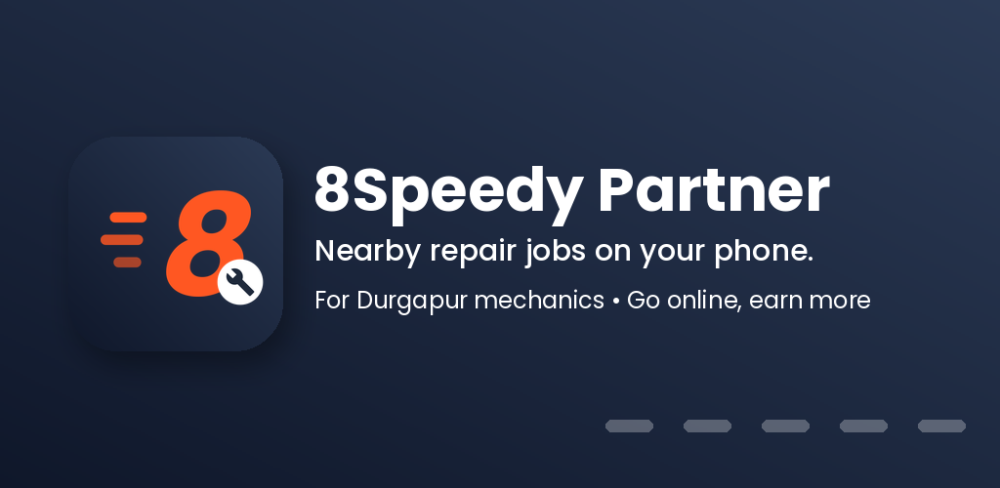
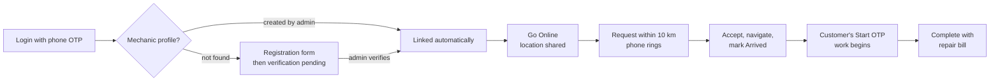

<div align="center">



# 8Speedy Partner

**The mechanic app for 8SpeedyService: go Online, get nearby repair requests that ring like a phone call, and finish the job with the customer's Start OTP.**


[About](#about) · [Features](#features) · [How it works](#how-it-works) · [Call-style alerts](#call-style-job-alerts) · [Tech stack](#tech-stack) · [Getting started](#getting-started) · [Roadmap](#roadmap)

</div>

---

## About

Local mechanics in Durgapur get most of their work from people who already know their shop. When someone breaks down a few kilometres away, that job never reaches them.

**8Speedy Partner** puts those jobs on the mechanic's phone. A verified mechanic switches **Online**, and every new breakdown request within 10 km rings the phone like an incoming call, with the vehicle, the distance, the problem and even the customer's voice note. The first mechanic to accept gets the job, navigates to the customer, starts the work with the customer's 4-digit OTP and closes it with a repair bill.

This is the second app of **8SpeedyService**, my on-demand roadside mechanic startup:

| | Customer app | Partner app (this repo) |
|---|---|---|
| Repository | [`8SpeedyService`](https://github.com/durgadas-karmakar07/8SpeedyService) | `8SpeedyService.Partner` |
| Package | `com.speedyservice.customer` | `com.speedyservice.partner` |
| Who uses it | People whose vehicle broke down | Verified local mechanics |

Both apps share one Supabase backend. The database migrations, Edge Functions and the legal website live in the [customer repository](https://github.com/durgadas-karmakar07/8SpeedyService).

**Status:** version 1.1.0, test APKs built by CI on every push. Next: real-phone testing, then Play Store closed testing.

## Features

| Feature | Status |
|---|---|
| Phone OTP login (same accounts system as the customer app) | Done |
| Self-registration (name, shop, vehicle types) → *verification pending* until an admin verifies the mechanic | Done |
| **Online / Offline switch;** while Online, location is shared and nearby requests appear on a map and a list | Done |
| **Call-style job alerts:** full-screen ringing alert with a 40-second countdown, even on the lock screen | Done |
| Request details before accepting: vehicle, distance, issues, a short AI summary of the problem and the customer's **voice note** | Done |
| First to tap **Accept Job** gets it | Done |
| Job screen: navigate with Google Maps, mark **Arrived**, enter the customer's **Start OTP**, complete | Done |
| Release a job before it starts (it goes back to other mechanics) | Done |
| In-app chat with the customer (quick replies) and a call button | Done |
| **AI repair guide** in English, Hindi or Bengali: likely causes, checklist, tools and parts, typical bill, safety tips | Done |
| Repair bill (amount and note) on completion, sent to the customer as a digital bill | Done |
| **Earnings & Jobs:** today, 7 days and 30 days, a 7-day chart, completion rate, rating and reviews | Done |
| Account & Privacy: privacy policy, partner terms, WhatsApp support, delete my account | Done |
| Push notifications when the app is closed (FCM) | Planned |
| Commission and payout tracking | Planned |

## How it works



- While Online, a **foreground service** keeps the app alive in the background, sends the location every 25 m or 60 seconds, and checks for new requests every 8 seconds (live updates come over Supabase Realtime, with polling as a safety net).
- If the customer cancels, the mechanic sees it within seconds.
- The repair charge is paid by the customer directly to the mechanic.

## Call-style job alerts

New requests should be impossible to miss, so the app rings like a phone call:

- **App open:** a full-screen incoming-request screen with ripples, the vehicle, distance, issues, a voice-note play button, a 40-second countdown and **Accept / Decline**.
- **App in the background or screen off:** a native Android `CATEGORY_CALL` notification with a **full-screen intent** that opens over the lock screen, and a looping ringtone that stops after 45 seconds.
- **Ringtone:** an original synthesized sound (generated by `tool/make_ringtone.py`), and it respects the phone's silent and vibrate modes.
- **Safe to open:** tapping the alert passes a one-time token, so another app cannot fake a job alert.
- Built with **native Kotlin** (`JobAlerts.kt`, `Ringer.kt`, `MainActivity.kt`) through a Flutter MethodChannel instead of third-party plugins, so it relies only on platform APIs.

On Android 14+, the Play Store turns full-screen alerts off for non-calling apps, so the home screen shows an **Allow full-screen alerts** banner that opens the right setting. Without it, the alert still rings as a heads-up notification.

## Privacy and fair use

- The customer's phone number is **not** included in job data; the call button fetches it through a logged, rate-limited request.
- The customer's Start OTP is never sent to the mechanic's phone; the mechanic must get it from the customer.
- Voice notes are played from short-lived signed links, and the server decides who may listen.
- Releasing jobs again and again is limited: 3 releases in 24 hours pauses the account for 12 hours, with a banner on the home screen.
- Only "while using the app" location is requested (no background location permission); sharing stops when the mechanic goes Offline.

## Tech stack

| Layer | Technology |
|---|---|
| App | Flutter 3.47+, Dart 3.14, Material, Poppins font |
| Maps and location | flutter_map with OpenStreetMap tiles, geolocator with a foreground service |
| Native Android | Kotlin: call-style notifications, ringtone, voice-note playback |
| Backend | Supabase: Phone OTP Auth, PostgreSQL with PostGIS, Row Level Security, `SECURITY DEFINER` RPCs |
| Real time | Supabase Realtime private broadcast topics, with adaptive polling as a fallback |
| AI | Large language model API through the shared `ai-assistant` Edge Function |
| CI | GitHub Actions: analyze, tests, screen previews, release APK, security checks, emulator smoke test |

The app talks to the backend **only through RPCs** (`lib/services/partner_service.dart`). It always tries the newest RPC version first and falls back to the older one, so new app versions keep working while the server is being updated, and older installs keep working after it is.

## Getting started

### Prerequisites

- [Flutter](https://docs.flutter.dev/get-started/install) 3.47 or newer (Dart 3.14), Android SDK, JDK 17+
- The backend from the [customer repository](https://github.com/durgadas-karmakar07/8SpeedyService) set up on a Supabase project (migrations and Edge Functions; see its `PRODUCTION_SETUP.md`)

### Run

```bash
git clone https://github.com/durgadas-karmakar07/8SpeedyService.Partner.git
cd 8SpeedyService.Partner

cp env/example.json env/prod.json    # fill in SUPABASE_URL and SUPABASE_ANON_KEY

flutter pub get
flutter analyze
flutter test
flutter run --dart-define-from-file=env/prod.json
```

`env/prod.json` is git-ignored. Only the publishable (anon) Supabase key goes in the app.

To try the full flow, create a mechanic account (or let the app register one) and set `mechanics.is_verified = true` for it in the Supabase dashboard.

### Release build

```bash
flutter build appbundle --release --obfuscate --split-debug-info=build/symbols --dart-define-from-file=env/prod.json
```

Play Console needs the **Foreground service (location)** and **Full-screen intent** declarations; the answers and the listing text are in [store/PLAY_STORE_LISTING.md](store/PLAY_STORE_LISTING.md).

## Project structure

```
8SpeedyService.Partner/
├── lib/
│   ├── screens/        Splash, login, account gate, registration, pending, home (Online map),
│   │                   incoming request (call screen), job, chat, earnings & history, account, legal
│   ├── services/       Auth, partner RPCs, live job updates, location (foreground service), alerts
│   ├── widgets/        AI repair guide, voice-note player, AI feedback, loaders
│   ├── models/         Job, request and stats models
│   └── core/           Constants, legal text, helpers
├── android/app/src/main/kotlin/   JobAlerts, Ringer, VoicePlayer, MainActivity
├── tool/make_ringtone.py          Generates the original ringtone
├── store/              Play Store listing text, icon and feature graphic
├── test/               Unit and widget tests
├── test_preview/       Renders the call screen and loaders to PNG in CI
└── .github/            CI workflow and APK check scripts
```

## Roadmap

- [x] Registration and verification, Online mode with live location
- [x] Call-style alerts with full-screen intent and an original ringtone
- [x] Voice notes, chat, AI repair guide, repair bills, earnings dashboard (v1.1.0)
- [ ] Push notifications (FCM) so alerts arrive even when the app is closed
- [ ] Crash reporting
- [ ] Play Store closed testing, then launch with the first mechanics in Durgapur
- [ ] Commission and payout tracking

## Author

**Durgadas Karmakar**, founder, B.Tech (IT) student, Bengal College of Engineering & Technology, Durgapur

- GitHub: [durgadas-karmakar07](https://github.com/durgadas-karmakar07)
- LinkedIn: [durgadas-karmakar](https://www.linkedin.com/in/durgadas-karmakar-60ab70429)
- Email: [durgadask96@gmail.com](mailto:durgadask96@gmail.com)
- Partner support: WhatsApp [+91 96352 97320](https://wa.me/919635297320)
